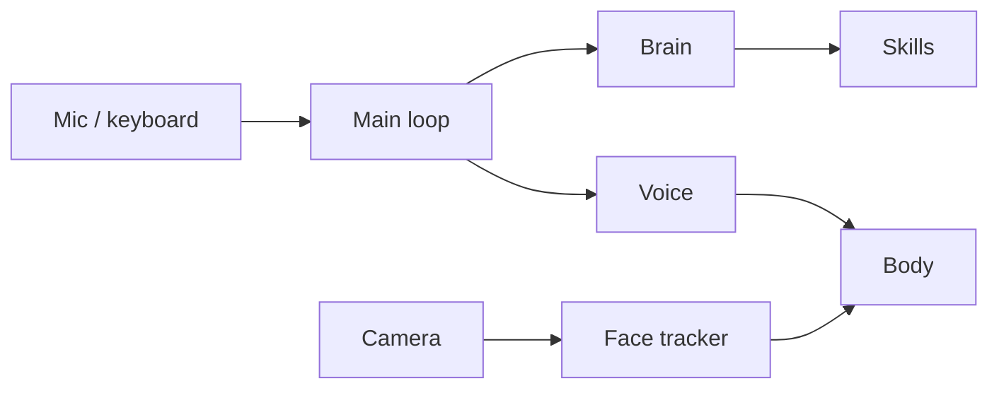

# PersonaAI

A robot head that talks back. It listens, answers in the language you spoke, and moves while it talks: blinks, moves its jaw with the voice and turns to look at you.

Made by the sySTEMatic Robotics team (FIIR, UNSTPB) for RoboChallenge.

This repo is a simplified public version of the software. It shows how the robot works and runs on any PC in simulation mode. The real hardware code, tuning, prompts and companion app are not included.

## Features

- wake word, then a normal conversation
- answers in the user's language
- skills: time, weather, "what is this?" (camera), live info
- blinking, thinking pose, talking pose
- jaw moves with the voice
- head follows the closest face
- say "stop" to interrupt, "goodbye" to put it to sleep

## How it works



More in [docs/architecture.md](docs/architecture.md).

## Run it

```bash
pip install -r requirements.txt
cp .env.example .env    # optional, add an LLM key for real answers
python -m persona
```

Type `hello` to wake it, chat, `goodbye` to sleep, `quit` to exit.

## Layout

```
persona/
  app.py       main loop
  brain.py     picks a skill or just chats
  config.py    settings from .env
  hardware/    body interface + simulator
  audio/       speech in/out, jaw sync
  vision/      face tracker
  skills/      time, weather, camera, search
docs/
```

## What's next

- a robotic arm for pointing and gestures
- a microphone array, so it turns toward whoever is talking
- the camera inside the eye
- AI running on the robot, no internet needed
- louder speakers for events

Details in [docs/roadmap.md](docs/roadmap.md).

## License

All rights reserved. See [LICENSE](LICENSE).
