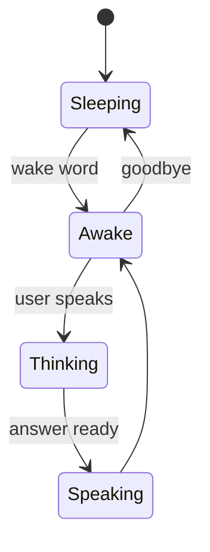

# Architecture

## Main loop

While awake, the robot blinks on its own and (if enabled) follows the closest face. Thinking and speaking run in the background, so "stop" works at any time.

## Brain

When the user says something, two requests start at once:

1. which skill should handle this?
2. a normal chat reply

If a skill matches, it answers. If not, the chat reply is already there. This saves one round-trip on normal conversation.

The skill list is built from the skills themselves, so adding a skill is enough for the brain to use it.

## Skills

A skill is a class with a `name`, a one-line `description` and a `run()` method that returns what to say. Return `None` to let the chat answer instead.

## Body

The rest of the code only uses these:

- `pose(...)`: neutral, sleep, listen, think, talk
- `blink()`
- `look(x, y)`: from -1 to 1
- `mouth(openness)`: from 0 to 1

A backend turns these into motor commands. Only the console simulator is included.

## Jaw sync

The voice is cut into short pieces. Loud pieces open the mouth, quiet ones close it. Loudness is compared to the loudest part of the same clip, so it works at any volume.

## Face tracking

Camera, find faces, take the biggest one (closest person), turn the head toward it smoothly. The version here is basic.
